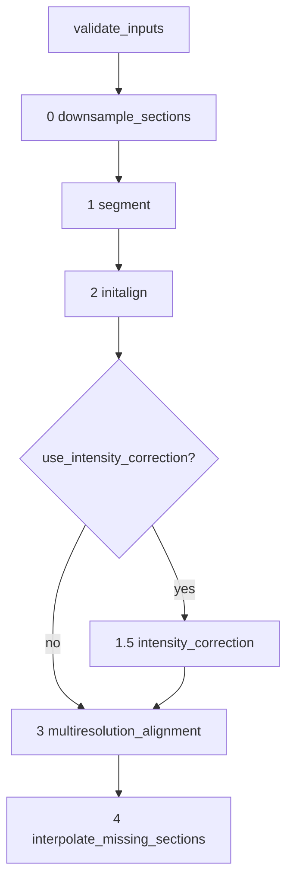

# Developer Guide

This guide describes BrainBuilder's architecture for developers: how the pipeline stages are orchestrated, how data flows between them through CSV manifests, and which columns each stage adds to the section and chunk tables.

## Architecture Overview

`brainbuilder.reconstruct.reconstruct()` is the entry point. It runs the stages in order, each stage reading and returning the path to a CSV manifest:

Stages communicate exclusively through pandas DataFrames serialized as CSVs. Each stage appends columns containing the paths of its per-section or per-chunk outputs; downstream stages look up their inputs from those columns rather than reconstructing paths. The canonical path schemas live in `brainbuilder/utils/paths.py` (`MultiResPaths`, `get_seg_fn`, `define_new_path_column`).

## Caching Model

- Each stage checks for its manifest CSV (e.g., `2_init_align/initalign_sect_info.csv`) and skips itself entirely if it exists.
- Within a stage, individual files are gated by `os.path.exists()` checks, so a partially completed stage resumes where it left off.
- `clobber=True` regenerates everything; `csv_clobber=True` deletes only the manifest CSVs (see `_get_pipeline_manifest_csvs()` in `reconstruct.py`), forcing stages to re-run their orchestration while reusing per-file outputs that already exist.

**Caveat:** because caching is filename-based, derived filenames must encode all of their upstream dependencies (notably the base resolution, which is embedded in the `img`/`seg` basenames). When adding new outputs, derive filenames from the row's `img` basename (e.g., via `get_seg_fn`) rather than from `row["base"]` or a fixed name in the output directory — otherwise changing `resolution_list` can silently reuse stale files.

Any new parallel block that shells out to ANTs must pin `ITK_GLOBAL_DEFAULT_NUMBER_OF_THREADS=1` (see `single_threaded_itk()` in `align/align_2d.py`); joblib's `inner_max_num_threads` is not sufficient because ITK ignores the OpenMP env vars.

## Section-Column Lifecycle

`sect_info` starts with the user-provided columns `sub, hemisphere, chunk, acquisition, raw, sample` and accumulates columns as it moves through the pipeline:

| Stage | Module | Columns added to `sect_info` |
|---|---|---|
| 0 Downsample | `downsample.py` | `img` — section downsampled to the base (finest) resolution |
| 1 Segment | `segment.py` | `seg` — tissue segmentation of `img` |
| 2 Init align | `initalign.py` | `init_tfm` (rigid 2D transform, `.h5`), `init_img` (rigidly aligned section), `init_fixed` (fixed image used), `original_img` (cache-validation copy of `img`) |
| 3.1 Intermediate volume | `align/intervolume.py` | `base` (basename from `raw`), `seg_rsl`, `seg_rsl_tfm` (segmentation resampled/transformed at the 3D resolution), `2d_align_3d_res` |
| 3.3 Align 2D | `align/align_2d.py` | `2d_tfm_affine`, `2d_tfm` (per-section 2D transforms), `2d_align`, `2d_align_cls` (nonlinearly aligned section and segmentation) |

Columns added to `chunk_info`:

| Stage | Columns |
|---|---|
| 2 Init align | `init_volume` — stacked rigid-aligned chunk volume |
| 3.2 Align 3D | `nl_3d_tfm_fn`, `nl_3d_tfm_inv_fn` (chunk↔reference composite transforms), `rec_3d_rsl_fn`, `ref_3d_rsl_fn`, `ref_rsl_fn` |
| 3.3 Align 2D | `nl_2d_vol_fn`, `nl_2d_vol_cls_fn` — chunk volumes rebuilt from 2D-aligned sections |
| 4 Interp | `interp_nat`, `interp_cls_nat`, `interp_stx`, `ref_vol_rsl_fn` |

The multiresolution loop in `volalign.py` repeats stages 3.1–3.3 for every resolution in `resolution_list` (and per `pass_`), overwriting the alignment columns each time so that they always point at the current-best outputs. See [outputs.md](outputs.md) for the corresponding files on disk.

## Module Map

| Module | Responsibility |
|---|---|
| `reconstruct.py` | Pipeline orchestration, CLI |
| `downsample.py` | Raw 2D → downsampled NIfTI sections |
| `segment.py` | Tissue segmentation (nnUNet v1/v2, Otsu, Triangle) |
| `initalign.py` | Sequential rigid 2D section-to-section alignment |
| `volalign.py` | Multiresolution loop; delegates to `align/` |
| `align/intervolume.py` | Builds intermediate chunk volumes from aligned sections |
| `align/align_3d.py` | 3D chunk-to-reference registration (ANTs) |
| `align/align_2d.py` | Per-section 2D registration to reference slices |
| `align/align_landmarks.py` | Optional landmark-based initialization |
| `interpsections.py`, `interp/` | Missing-section interpolation (volumetric via `morphint`, or surface-based) |
| `qc/` | Quality-control metrics and reports |
| `utils/` | ANTs wrappers, NIfTI I/O, path schemas, mesh utilities |

## Testing

- Unit tests: `tests/` (`pytest tests/`).
- Integration test: `tests/integration_test.py`, driven by synthetic data from `brainbuilder/tests/generate_synthetic_data.py`.
- `morphint` has its own tests under `morphint/tests/`.

Linting uses [Ruff](https://github.com/astral-sh/ruff); configuration is in [pyproject.toml](../pyproject.toml).
